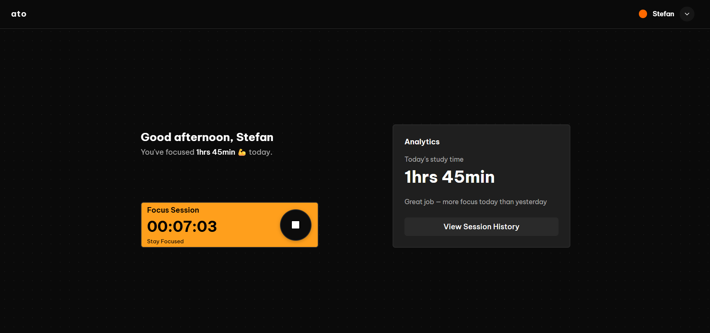
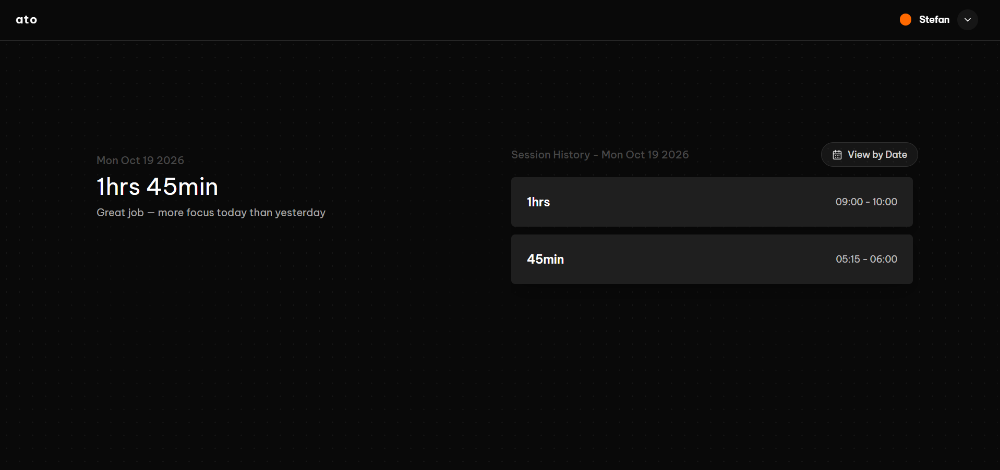

# Ato

Ato is a full-stack study-time tracker that helps people build a clearer picture of their focus habits. Start and stop a timer, save study sessions, review daily history, and compare today's progress with yesterday's. Users can register or explore the app with guest access.

## Screenshots

### Study Timer


### Analytics and Feedback


## Features

- Start and stop a study timer and save completed sessions.
- Browse session history by date and review daily study-time totals.
- Receive feedback comparing today's focus time with yesterday's.
- Register, log in, use guest access, and convert a guest account.
- Manage account details, including changing a password.

## Tech stack

- **Frontend:** React 19, TypeScript, Vite, React Router, TanStack Query, Tailwind CSS, Lucide React
- **Backend:** Node.js, Express 5, PostgreSQL (`pg`), Zod, JSON Web Tokens, bcrypt
- **Testing:** Vitest, React Testing Library, and jsdom for client tests; Vitest for server tests

## Getting started

### Prerequisites

- Node.js and npm
- PostgreSQL

### Install and configure

1. Clone the repository and install each application's dependencies:

   ```sh
   git clone https://github.com/Stefan1400/ato.git
   cd ato
   ```

   In separate terminal sessions:

   ```sh
   cd server
   npm install
   ```

   ```sh
   cd client
   npm install
   ```

2. Create a PostgreSQL database. Copy `server/.env.example` to `server/.env` and fill in the database connection settings and a private JWT signing secret:

   ```text
   DB_USER=
   DB_HOST=
   DB_NAME=
   DB_PASS=
   DB_PORT=5432
   JWT_SECRET=
   ```

   `DB_PORT` defaults to `5432` if omitted.

3. Initialize the schema in the database you created. From the repository root, run:

   ```sh
   psql -d YOUR_DATABASE_NAME -f server/schema.sql
   ```

   Replace `YOUR_DATABASE_NAME` with the database name configured as `DB_NAME`. The database must already exist, and PostgreSQL's command-line tools and database access must be configured for `psql`. The schema file creates the `users` and `sessions` tables and an index in that database. The server may also add `users.account_type` automatically if it is missing.

### Run locally

Start the backend and frontend in separate terminals:

```sh
cd server
npm run dev
```

```sh
cd client
npm run dev
```

The API listens on `http://localhost:5000`; the frontend uses Vite's default development port (`http://localhost:5173`) and is configured to call that local API.

## Testing

Run the test suites from their respective application directories:

```sh
cd client
npm test -- --run
```

```sh
cd server
npm test -- --run
```

The client suite uses Vitest with jsdom and React Testing Library. The server suite uses Vitest in a Node environment.

## Technical highlights

- **Cookie-based authentication:** The API uses signed JWTs in HTTP-only cookies; account passwords are hashed with bcrypt.
- **Separated API routes and validation:** Express routes are grouped for users, sessions, and feedback, with Zod request schemas and shared middleware.
- **Date-aware session history:** The client calculates local-day boundaries and sends ISO timestamps. The API retrieves sessions that overlap the requested date range, including sessions crossing a day boundary.
- **Derived analytics and feedback:** The server calculates daily total, longest, and average session durations and uses today's and yesterday's sessions to generate progress feedback. TanStack Query caches data and refreshes session and feedback queries after a session is saved.